 

 

  

<h2 align="center">⚡ ABOUT ME</h2>

 

<table align="center">
<tr>
<td align="center" width="250"><h3>🌱</h3><b>LEARNING</b> Node.js · HTML · CSS · JS</td>
<td align="center" width="250"><h3>🔒</h3><b>BUILDING</b> Private Projects</td>
<td align="center" width="250"><h3>🎯</h3><b>AIMING FOR</b> Full Stack Mastery</td>
</tr>
</table>

<h2 align="center">🧠 SKILLS</h2>

  

<h2 align="center">🚀 PROJECTS</h2>

 

<h2 align="center">📊 STATS</h2>

<h2 align="center">📡 LET'S CONNECT</h2>

  

